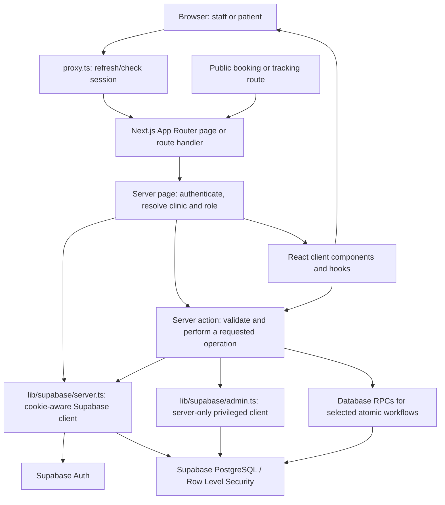

# SamayQ

SamayQ is a web application for managing the day-to-day work of healthcare
clinics. Staff can manage appointments, patient queues, doctors, departments,
rooms, patients, team access, and clinic settings. Patients can also book
appointments from a public clinic link and follow a booking or queue through a
tracking link.

This guide explains the application in plain language: its architecture,
important data structures, request flows, folders, and the purpose of each
source file.

## Contents

- [At a glance](#at-a-glance)
- [Technology](#technology)
- [Architecture](#architecture)
- [How a request works](#how-a-request-works)
- [Roles and access](#roles-and-access)
- [Data model](#data-model)
- [Data structures in the code](#data-structures-in-the-code)
- [Reliability and concurrency](#reliability-and-concurrency)
- [Project folders and files](#project-folders-and-files)
- [Run locally](#run-locally)
- [Environment variables](#environment-variables)
- [Important implementation notes](#important-implementation-notes)

## At a glance

| Area | Responsibility |
|---|---|
| Platform dashboard | Gives platform administrators access to clinic management and an overview. |
| Clinic operations | Provides appointment, queue, doctor, department, room, and patient workflows. |
| Public booking | Lets a patient request an appointment using a clinic-specific public code. |
| Tracking | Shows public appointment or queue progress using a tracking token. |
| Team management | Invites staff and manages clinic membership and screen permissions. |
| Authentication | Uses Supabase Auth for login, sign-up, confirmation, password recovery, and sessions. |

## Technology

- **Next.js App Router** organizes URL routes, server-rendered pages, route
  handlers, and server actions.
- **React** builds the interactive client-side screens.
- **TypeScript** describes data and action inputs so invalid shapes are easier
  to catch during development.
- **Supabase** provides authentication and the PostgreSQL data API. Server-side
  functions also call Supabase database RPC functions for selected operations.
- **Tailwind CSS** supplies the utility-based styling.
- **Resend** is used by the email test route. Team invitations use the
  configured email integration in the team action.

## Architecture



In everyday terms, the server first identifies the user and the clinic they
may access. It loads the data needed by the page, then passes that data to
interactive React components. When a user submits a change, a server action
validates the request and communicates with Supabase. Some queue, invitation,
booking, and tracking operations are delegated to database RPCs.

## How a request works

1. The browser requests a URL such as `/appointments?clinicId=...`.
2. `proxy.ts` calls the Supabase session helper so cookies and auth claims stay
   current. Individual pages and server actions still perform their own
   authentication and authorization checks.
3. The server page reads the authenticated user and checks platform-admin or
   clinic-membership records as required by that feature.
4. The page fetches the necessary clinic-scoped records from Supabase.
5. The page renders server-side UI and passes data into client components when
   interaction is needed.
6. A client component submits a server action. The action validates the input,
   verifies access, and either updates data directly or calls a database RPC.
7. The client displays the result; pages may be revalidated so the next render
   reflects the latest data.

## Roles and access

The application uses these role concepts:

- **Master/platform admin**: platform-level access, including choosing a clinic
  to manage.
- **Clinic administrator**: manages the assigned clinic.
- **Receptionist**: handles operational tasks; the dashboard can receive a
  configured list of allowed screens.
- **Doctor**: linked to a doctor profile and an active clinic assignment.

Access is represented in application code through records such as
`platform_admins`, `clinic_memberships`, `team_permissions`, and
`doctor_clinic_assignments`. The exact access policy also depends on the
Supabase Row Level Security (RLS) policies configured in the database.

The app has two Supabase client patterns:

- `lib/supabase/server.ts` uses the logged-in user's cookies. Use this for
  normal user-scoped operations so database policies can apply.
- `lib/supabase/admin.ts` creates a server-only service-role client for
  privileged operations. A service-role key can bypass RLS; therefore it must
  never be exposed to the browser, and each server action using it must first
  authorize the caller.

## Data model

The code uses the following main business records. These are conceptual
relationships inferred from how the application queries Supabase; the
database schema itself is managed outside this repository.

## Database Design

The SamayQ database is designed to support a multi-clinic Appointment and Queue Management System. Each clinic can have multiple staff members, departments, doctors, patients, appointments, and queues. User profiles are connected to clinics through clinic memberships, which define access roles such as clinic administrator, receptionist, and doctor. Doctors are assigned to clinics through doctor-clinic assignments, allowing them to work across multiple clinics.

Patients are registered under a clinic and can book appointments through a public booking link without requiring a patient login. The system supports configurable booking modes, allowing clinics to choose between doctor-wise booking, department-wise booking, or custom booking configurations based on their requirements.

Each clinic can also configure its queue settings, including shared or separate queues for managing patient flow. Queues can be organized by doctors or departments, depending on the clinic's configuration. Queue entries represent patients waiting to be served and are associated with their respective queues. Rooms can be assigned to queue entries to manage patient flow through different consultation or service areas.

This flexible database structure supports multiple clinic workflows while ensuring proper data organization, clinic-level data isolation, role-based access control, and efficient appointment and queue management.


- A **clinic** is the tenant boundary for day-to-day business records.
- A **clinic membership** associates a user profile with a clinic and a role.
- A **doctor-clinic assignment** represents a doctor's work at a specific
  clinic and carries clinic-specific settings.
- An **appointment** connects a patient to a clinic, date/time, and a doctor
  assignment or department.
- A **queue** organizes patients for a clinic, doctor assignment, or department.
- A **queue entry** represents one patient's place and status in that queue.
- A **room** can be associated with queue work as a patient is called or moved.
- Clinic settings configure booking mode and related operational options.

## Data structures in the code

The application uses standard TypeScript and JavaScript structures rather than
custom data-structure implementations:

| Structure | Use in SamayQ |
|---|---|
| Object / TypeScript type | Describes one record or request shape, such as a `Clinic`, `Appointment`, or `QueuePatient`. |
| Array | Holds lists returned from Supabase and lists rendered by React. |
| `map()` | Converts database rows into UI options or display models. |
| `filter()` | Selects matching clinics, appointments, queue entries, or permissions. |
| `find()` | Locates one matching record in an array. |
| `Map` | Indexes related records by ID, such as patient ID to patient details, for convenient lookup. |
| `Set` | Removes duplicate IDs or counts unique patients. |
| String unions | Restrict known values, such as booking mode, queue status, view mode, and role. |
| React state | Stores values that change during use, such as form fields, filters, selected dates, and loading state. |

For example, the queue loader converts database rows into `QueuePatient`
objects that are easier for the UI to render. It uses `Set` to make a unique
list of patient IDs and `Map` objects to look up patient, doctor, department,
room, and queue information by ID.

## Reliability and concurrency

- Inputs are validated in server actions as well as in the UI. UI validation
  improves usability; server validation is still required because requests can
  be submitted without using the UI.
- Clinic and role checks are performed before sensitive operations. Supabase
  RLS should also be configured and tested as a database-level enforcement
  layer.
- Queue registration and queue-state changes call database RPCs such as
  `register_walk_in_patient` and `manage_queue_entry`. Public booking and
  invitation acceptance also use RPCs.
- A database RPC can keep related database work together and is the appropriate
  place for operations that need transaction or locking guarantees. **The SQL
  definitions of these functions are not in this repository**, so their
  transaction, locking, and race-condition guarantees must be verified in the
  connected Supabase project.
- Queue business-date logic uses India Standard Time and treats the business
  day as starting at 3:00 AM, so activity before that time belongs to the
  previous business date.
- Server actions surface errors to their caller and log selected failures.
  Some pages show a user-friendly access or data-loading message instead of
  rendering the protected feature.

## Project Structure

The project follows the Next.js App Router architecture, with features organized into separate folders for better maintainability, code reusability, and separation of responsibilities.

### 1. `app/` – Application Routes and Features

This is the main folder containing all application pages and their functionality.

| Folder | Purpose |
| `account/` | Manages user profile information and account settings. |
| `api/` | Handles API endpoints, such as sending test emails. |
| `appointments/` | Handles appointment scheduling, booking, cancellation, calendar views, and appointment management. |
| `auth/` | Manages authentication, login, registration, password recovery, and staff invitations. |
| `book/[code]/` | Provides a public booking page where patients can book appointments using a clinic-specific link. |
| `clinics/` | Allows platform administrators to create, manage, and monitor clinics. |
| `dashboard/` | Displays the clinic dashboard with an overview of clinic operations. |
| `departments/` | Manages clinic departments, including creating, updating, and activating or deactivating departments. |
| `doctors/` | Manages doctors, their clinic assignments, availability, and schedules. |
| `history/` | Displays historical patient and operational activity. |
| `insights/` | Displays operational statistics and insights. |
| `patients/` | Manages patient records, search, and patient information. |
| `queues/` | Handles patient registration, token generation, queue management, walk-ins, and queue status updates. |
| `rooms/` | Manages consultation rooms, patient calling, and movement between rooms. |
| `settings/` | Manages clinic configurations, booking preferences, queue settings, and public booking options. |
| `team/` | Manages clinic staff, invitations, and role-based access. |
| `track/[token]/` | Provides patients with a public tracking page to check their queue status using a tracking link. |

**Shared components:** `app/components/` contains reusable application components such as the navigation bar, clinic dashboard, and business management modal.

### 2. `components/` – Reusable UI Components

Contains reusable interface elements such as buttons, cards, forms, authentication components, badges, and dropdown menus. These components help maintain a consistent user interface across different pages.

### 3. `lib/` – Shared Utilities and Backend Configuration

Contains shared functionality used throughout the application.

- `supabase/client.ts` – Creates the Supabase client for browser-side operations.
- `supabase/server.ts` – Creates the Supabase client for server-side operations.
- `supabase/admin.ts` – Provides privileged server-side database access for administrative operations.
- `supabase/proxy.ts` – Handles session management and authentication cookie updates.
- `utils.ts` – Contains shared utility functions.

### Application Architecture

The project separates responsibilities across different layers:

- **Pages (`page.tsx`):** Handle routing, authentication, authorization, and initial data loading.
- **Client Components:** Handle user interactions, forms, filters, and dynamic UI updates.
- **Server Actions (`actions.ts`):** Handle database operations, validation, and business logic securely on the server.
- **Hooks and Utilities:** Manage reusable state, data fetching, formatting, and helper functions.
- **Supabase:** Handles authentication, database storage, real-time updates, and Row Level Security (RLS).

This structure keeps the application modular, maintainable, and easier to extend as new clinics and features are added.

## Run locally

Requirements: Node.js/npm and access to a configured Supabase project.

1. Install packages:

   ```bash
   npm install
   ```

2. Copy `.env.example` to `.env.local` and fill in the values from your own
   Supabase project. Add any additional server-only variables required by the
   optional email, invitation, tracking, and deployment features.
3. Start the development server:

   ```bash
   npm run dev
   ```

4. Open `http://localhost:3000`.

Available scripts:

```bash
npm run dev    # Start the Next.js development server
npm run build  # Create a production build
npm run start  # Serve the production build
npm run lint   # Run ESLint
```

## Environment variables

Never commit `.env.local`, service-role keys, email secrets, or tracking
secrets. The project reads these variables in server-side code:

| Variable | Used for |
|---|---|
| `NEXT_PUBLIC_SUPABASE_URL` | Supabase project URL. |
| `NEXT_PUBLIC_SUPABASE_PUBLISHABLE_KEY` | Browser-safe Supabase publishable/anon key. |
| `SUPABASE_SERVICE_ROLE_KEY` | Server-only privileged Supabase client. |
| `RESEND_API_KEY` | Resend API access for the test-email route. |
| `RESEND_FROM_EMAIL` | Sender address for the test-email route. |
| `EMAILJS_SERVICE_ID` | EmailJS service used by team invitation code. |
| `EMAILJS_TEMPLATE_ID` | EmailJS invitation template. |
| `EMAILJS_PUBLIC_KEY` | EmailJS public configuration value. |
| `EMAILJS_PRIVATE_KEY` | Server-side EmailJS private configuration value. |
| `TRACKING_TOKEN_SECRET` | Secret used to create queue tracking tokens. |
| `NEXT_PUBLIC_SITE_URL` | Base site URL used to construct public links. |
| `VERCEL_URL` | Optional deployment URL used for metadata base. |

Set only the variables needed by the feature/environment you are running.
Keep all secret values on the server and rotate them if they are ever exposed.

## Important implementation notes

- **Database configuration is external.** This repository contains application
  code but no SQL migration files. Table definitions, RLS policies, indexes,
  triggers, and RPC implementations must be inspected in the Supabase project.
- **Validate RLS and RPC behavior before production.** Application checks are
  not a substitute for database permissions. Confirm policies restrict all
  clinic-scoped data and verify transaction/locking behavior in the deployed
  RPC definitions.
- **Public routes still need constrained data access.** Public booking and
  tracking use code/token-based RPCs; those functions must validate tokens,
  clinic state, input, and returned data on the database side.
- **A clinic ID in the URL is a selection, not proof of permission.** Pages and
  server actions must verify that the authenticated user can access that clinic.
- **Avoid placing service-role operations in client code.** `admin.ts` is
  marked server-only for this reason.
- **Feature code is organized by route.** When changing a feature, check its
  page, server actions, client component, types, and related Supabase policies
  or RPCs together.
